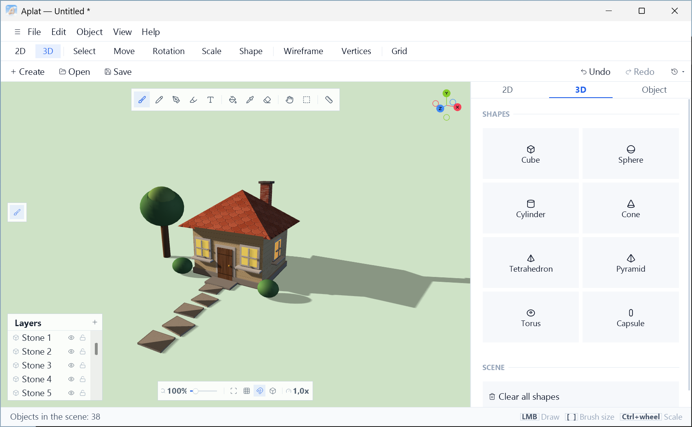
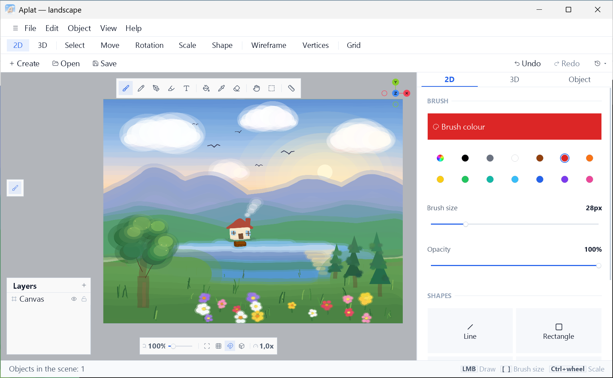

<picture>
  <source media="(prefers-color-scheme: dark)" srcset="assets/brand/logo-dark.png">
  
</picture>

# Aplat

A Windows editor that puts 2D painting on a canvas and a 3D scene of shapes, materials and light in one window.

**English** · [Русский](README.ru.md)

 

 

<picture>
  <source media="(prefers-color-scheme: dark)" srcset="docs/screenshots/scene-dark.png">
  
</picture>

## Features

- **2D painting.** Brush, pencil, pen, marker, fill, eyedropper, shapes, text, area selection and lasso. Shapes,
  text and selections stay editable until you commit them.
- **3D scene.** Primitives, move, rotate and scale, groups, and a Shape mode for editing vertices, edges and faces.
  You can also paint on the surface of shapes.
- **Materials and light.** Metalness, roughness, glow, transparency, textures and local lights. A sun with
  adjustable azimuth and elevation, highlights and soft shadows.
- **Ruler.** A wooden ruler is a scene object: it guides a straight line along its edge, and in 3D it can be moved,
  rotated and scaled.
- **Undo history.** Limited by memory use. A part of the latest actions is saved with the project.
- **Model and image export.** OBJ, STL, FBX, PNG and JPG, plus turntable frames as PNG files (to assemble an
  animation in another program).

All features and limitations are described in [FEATURES.md](FEATURES.md).

## Quick start

1. Start Aplat: a scene with an empty canvas opens.
2. Pick the brush (**B**) and draw something on the canvas.
3. Add a 3D shape with the "+" menu of the Objects panel and move it around (**F2**–**F4**).
4. Orbit the scene: the right mouse button rotates the camera, the wheel zooms, and the keys **1**, **3**, **7**,
   **0** switch views.
5. Save the project (Ctrl+S).

> **Autosave.** If a project already has a file, changes are written into it automatically, even without Ctrl+S.
> After opening someone else's or an original file, choose "Save As" right away, before changing anything.

 

<picture>
  <source media="(prefers-color-scheme: dark)" srcset="docs/screenshots/paint-dark.png">
  
</picture>

## Install

1. Download `Aplat-<version>-Setup.exe` from the [Releases](../../releases/latest) page.
2. Check its SHA-256 against the published `.sha256` file. A checksum protects against a corrupted download but
   does not prove who published the file: download only from the Releases page of this repository.
3. Run it. It installs for the current user only and needs no administrator rights.

If you prefer no installer, download `Aplat-<version>-Portable.zip`, unpack it anywhere and run `Aplat.exe`.

**Updates.** Aplat checks GitHub for a newer release at start-up (at most once a day) and tells you; it never
downloads or installs anything by itself. Turn the check off in **Help → Check for updates at start-up**.

### System requirements

| Component | Requirement |
|---|---|
| System | Windows 10 or newer |
| Platform | .NET Framework 4.7.2 (included in Windows 10 since version 1803; earlier builds of Windows 10 need it installed separately) |
| Graphics | A GPU with an OpenGL 1.1 or newer driver; shadows need OpenGL 2.0 with framebuffer objects |

Builds are not code-signed yet, so SmartScreen may show a warning.

## Hotkeys

| Keys | Action |
|---|---|
| <kbd>Ctrl</kbd>+<kbd>Q</kbd> | Search every command |
| <kbd>B</kbd> · <kbd>E</kbd> · <kbd>R</kbd> | Brush · eraser · ruler |
| <kbd>[</kbd> <kbd>]</kbd> or <kbd>Alt</kbd>+wheel | Brush size |
| <kbd>1</kbd> <kbd>3</kbd> <kbd>7</kbd> <kbd>0</kbd> | Front · side · top · perspective |
| <kbd>F7</kbd> · <kbd>F9</kbd> | Lighting and sun · auto-rotate |
| <kbd>Shift</kbd> while drawing | Straight line, square, circle |

The complete list is in the app under **Help → Hotkeys**.

## For developers

Building, tests and the installer are described in [CONTRIBUTING.md](CONTRIBUTING.md) and
[installer/README.md](installer/README.md). Issues and pull requests are welcome; to report a security problem,
follow [SECURITY.md](SECURITY.md) instead of opening a public issue.

## License

[Apache-2.0](LICENSE.txt). Copyright 2026 vindfjur. Third-party components (OpenTK, Lucide icons) are
listed in [THIRD_PARTY_NOTICES.md](THIRD_PARTY_NOTICES.md).

 
Aplat (French): a flat, even wash of colour in painting.

