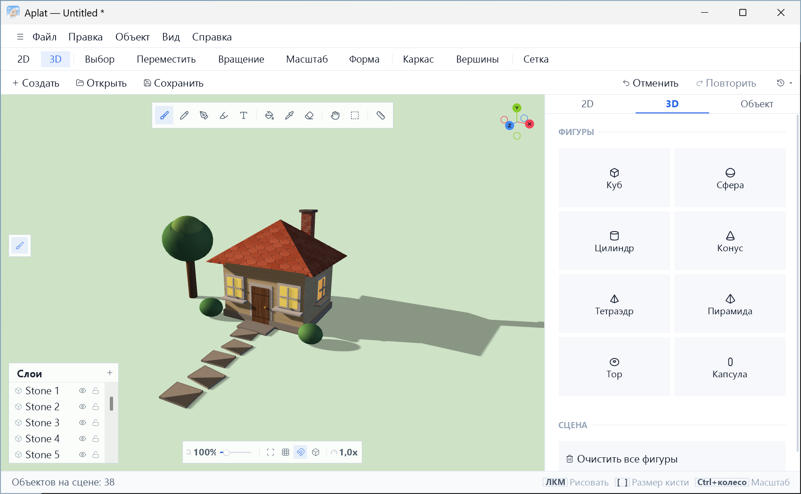
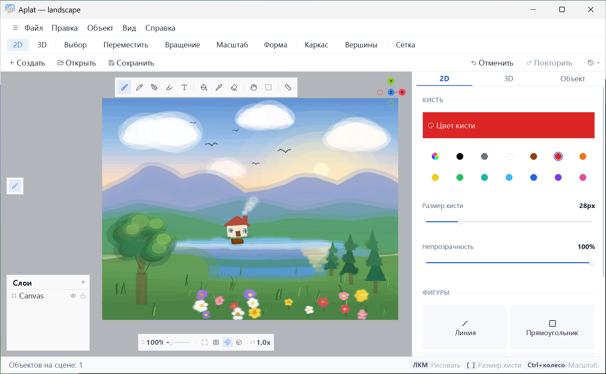

<picture>
  <source media="(prefers-color-scheme: dark)" srcset="assets/brand/logo-dark.png">
  
</picture>

# Aplat

Редактор для Windows: 2D-рисование на холсте и 3D-сцена из фигур, материалов и света в одном окне.

[English](README.md) · **Русский**

 

 

## Возможности

- **2D-рисование.** Кисть, карандаш, ручка, маркер, заливка, пипетка, фигуры, текст, выделение области и лассо.
  Фигуры, текст и выделения можно редактировать, пока вы их не закрепите.
- **3D-сцена.** Примитивы, перемещение, вращение и масштаб, группы, режим «Форма» для правки вершин, рёбер и
  граней. Рисовать можно и по поверхности фигур.
- **Материалы и свет.** Металличность, шероховатость, свечение, прозрачность, текстуры, локальные источники света.
  Солнце с настройкой азимута и высоты, блики и мягкие тени.
- **Линейка.** Деревянная линейка — объект сцены: по её краю можно вести прямую линию, а в 3D её можно двигать,
  вращать и масштабировать.
- **История отмены.** Ограничена расходом памяти. Часть последних действий сохраняется вместе с проектом.
- **Экспорт моделей и изображений.** OBJ, STL, FBX, PNG и JPG, а также кадры оборота камеры в виде PNG (для
  сборки анимации в другой программе).

Все возможности и ограничения описаны в [FEATURES.ru.md](FEATURES.ru.md).

## Быстрый старт

1. Запустите Aplat: откроется сцена с пустым холстом.
2. Выберите кисть (**B**) и нарисуйте что-нибудь на холсте.
3. Добавьте 3D-фигуру через меню «+» в панели «Объекты» и подвигайте её (**F2**–**F4**).
4. Облетите сцену: правая кнопка мыши вращает камеру, колесо приближает, цифры **1**, **3**, **7**, **0**
   переключают виды.
5. Сохраните проект (Ctrl+S).

> **Автосохранение.** Если у проекта уже есть файл, изменения записываются в него автоматически, даже без Ctrl+S.
> Открыв чужой или исходный файл, сразу выберите «Сохранить как», пока ничего не изменили.

 

## Установка

1. Скачайте `Aplat-<версия>-Setup.exe` на странице [Releases](../../releases/latest).
2. Сверьте его SHA-256 с опубликованным файлом `.sha256`. Контрольная сумма защищает от повреждённой загрузки, но
   не подтверждает, кто издатель файла: скачивайте только со страницы Releases этого репозитория.
3. Запустите. Установка идёт только для текущего пользователя и не требует прав администратора.

Если установщик не нужен, скачайте `Aplat-<версия>-Portable.zip`, распакуйте куда угодно и запустите `Aplat.exe`.

**Обновления.** Aplat проверяет на GitHub, не вышла ли новая версия, при запуске (не чаще раза в сутки) и
сообщает об этом; сам он ничего не скачивает и не устанавливает. Проверка отключается в
**Справка → Проверять обновления при запуске**.

### Системные требования

| Компонент | Требование |
|---|---|
| Система | Windows 10 или новее |
| Платформа | .NET Framework 4.7.2 (входит в Windows 10 начиная с версии 1803; в более ранних сборках Windows 10 его нужно установить отдельно) |
| Графика | Видеокарта с драйвером OpenGL 1.1 или выше; для теней нужен OpenGL 2.0 с framebuffer-объектами |

Сборки пока не подписаны, поэтому SmartScreen может показать предупреждение.

## Горячие клавиши

| Клавиши | Действие |
|---|---|
| <kbd>Ctrl</kbd>+<kbd>Q</kbd> | Поиск по всем командам |
| <kbd>B</kbd> · <kbd>E</kbd> · <kbd>R</kbd> | Кисть · ластик · линейка |
| <kbd>[</kbd> <kbd>]</kbd> или <kbd>Alt</kbd>+колесо | Размер кисти |
| <kbd>1</kbd> <kbd>3</kbd> <kbd>7</kbd> <kbd>0</kbd> | Спереди · сбоку · сверху · перспектива |
| <kbd>F7</kbd> · <kbd>F9</kbd> | Освещение и солнце · автовращение |
| <kbd>Shift</kbd> при рисовании | Ровная линия, квадрат, круг |

Полный список — в программе: **Справка → Горячие клавиши**.

## Для разработчиков

Сборка, тесты и устройство установщика описаны в [CONTRIBUTING.md](CONTRIBUTING.md) и
[installer/README.md](installer/README.md). Issues и pull request-ы приветствуются; о проблеме безопасности
сообщайте по [SECURITY.md](SECURITY.md), а не публичным issue.

## Лицензия

[Apache-2.0](LICENSE.txt). Copyright 2026 vindfjur. Сторонние компоненты (OpenTK, иконки Lucide)
перечислены в [THIRD_PARTY_NOTICES.md](THIRD_PARTY_NOTICES.md).

 
Aplat (фр.) — ровная, однородная заливка цветом в живописи.

